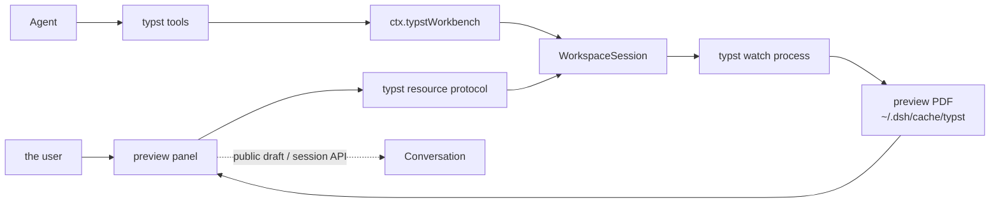

<a href="architecture.md"><b>中文</b></a>

# Architecture

dsh-typst is a request-driven plugin: loading it starts no typst and touches nothing on disk. The first tool call, or the panel's first subscription to a workspace, is what creates that workspace's session. This document describes the layer responsibilities, the data flow, the service surfaces and the design boundaries.

## Overview

The host half is `ctx.typstWorkbench` (`src/service.ts`). It owns the `WorkspaceSession` registry keyed by the realpath of the workspace root, the plugin configuration lifecycle, the Typert manifest and scope lookup, the 7 agent tools. The browser half lives in `src/client/`: a right-sidebar tab, the `typst` resource protocol, the `typst` wire namespace and the tool cards.

The contract between the two halves is the view types in `src/contract.ts` and the strict zod codecs in `src/wire-schemas.ts`: the host materializes the host codecs, the client materializes the client codecs, and both arms share one structure.

## Data flow

The panel reads state through the resource protocol `dsh-resource://typst/state/<sessionId>`: the first frame is the current state, and every later frame follows one relevant change. PDF bytes are pulled separately through `typst/readPreview` by exact generation/seq/sha256 identity. Snapshots also carry main and compile run. A replacement commits after its first page and text layer are ready. Older previews and failures are explicit; a failed stream reconnects through a new resource subscription.

## Core layers

### Service layer (`src/service.ts`)

`TypstWorkbenchService` (the Cordis key `typstWorkbench`) is the plugin's stable outward boundary. It does four things: create and reuse `WorkspaceSession`s keyed by the realpath of the workspace root; register the Typert manifest and the `typstScope` lookup that resolves a wire SessionId into a workspace root, following the `workspaceFileScope` pattern; register the 7 tools and the `typst` skill; and close every session on dispose.

The configuration is volatile: on `loader/volatile-update`, every live session looks the typst executable up once more, and the sessions converge without a remount.

### Session layer (`src/workspace/session.ts`)

The session also separates **documents** from **fragments**: a fragment is a `.typ` file the current document pulls in with `#include` or `#import`, named by typst's own dependency report (`typst --deps`). The state frame's `fragments` field carries it, and the panel lists the two kinds apart.

typst reports the paths it resolved, and a resolved path is the real one: macOS's temporary directory is a symlink to `/private/var`, so the report and the workspace root spell the same file two ways. Both sides are resolved before they are compared — otherwise the dependency report is silently dropped, which is how `sourceFiles()` once found no file at all.

`WorkspaceSession` holds the whole state of one workspace: the toolchain, the main file, the watch process, the snapshots, the highlights, the settle semantics and the path confinement. What it exposes are actions (`activate`, `setMain`, `settle`, `renderPages`, `exportPdf`, `highlight`, `locateSource`) and the read-only `state()`, never the process internals.

Path safety lands in this layer: `insideWorkspace` resolves every path to an absolute path inside the workspace, and an escaping path is refused with `TYPST_PATH_OUTSIDE_WORKSPACE`.

### Typst domain (`src/typst/`)

- **Executable location** (`locate.ts`): searches the setting, then PATH, then the common install locations, then the login shell; parses the version and compares it against `MIN_TYPST` (0.12.0).
- **Watch driver** (`watcher.ts`): the only place a process is spawned. It owns its process group, writes a pid file and tears the tree down; `reapOrphans` collects leftovers from an earlier crash.
- **Output parsing** (`diagnostics.ts`): parses `typst watch` output into a `WatchLog` and the diagnostic list, with locations, source lines, `hint:` lines and the call trace.
- **Main-file selection** (`mainfile.ts`): scans the `.typ` candidates and picks the main file.
- **Text matching** (`match.ts`, `text.ts`): maps rendered text back to a source location, producing quotes, highlight rectangles and excerpts.
- **One-shot compiles** (`oneshot.ts`): page rendering and PDF export compile on their own rather than through the watch.
- **PDF parsing** (`pdf-extract.ts`): reads the page count and the page text with pdf.js.

### Tool layer (`src/tools/`)

`src/tools/registration.ts` registers the 7 tools, one effect each (unregistration is that effect's own teardown). The schemas use the dsh-tools value-schema DSL: `required` is a per-property annotation, and a nested object declares `additionalProperties: false` explicitly.

The canonical output is lossless JSON (an absent optional fact is omitted rather than typed as null), and the model sees a separate `render` text. The canonical value of `typst_render_pages` carries base64 PNGs; the tool card displays them.

### Wire layer (`src/typert.ts`, `src/contract.ts`, `src/wire-schemas.ts`, `src/status-codec.ts`)

The wire namespace is `typst`, the service key `typstStatus`. The manifest is hand-written: `ctx.typert.register()` is the official path for hand-written wire schemas, and this repository is a standalone checkout without the `tsconfig.host.json` and `packages/` the Typert generator needs.

`watch` is a stream method; its manifest signature carries the prefix `@Remote({ mode: 'stream' })` and its descriptor carries `mode: 'stream'`. The bytes of `readPreview` ride the wire as an attachment, and its `data` field is a `Uint8Array<ArrayBuffer>`.

A domain error of the plugin's own crosses the wire under exactly one code, `typst/domain`, with the stable domain code in `details.code`; consumers discriminate by `details.code`, never by `instanceof`.

### Browser client (`src/client/`)

- **The preview panel** (`PreviewTab.tsx`): a right-sidebar tab of kind `typst`, id `dsh-typst/preview`, registered as a definition and a keyed body under the same id.
- **The resource protocol** (`provider.ts`): registers the `typst` protocol at the address `dsh-resource://typst/state/<sessionId>`.
- **The Remote namespace** (`remote.ts`): mounts `ctx.remote.typst`. `src/client/index.ts` must `await ctx.remote.$mount` first, so the UI fiber can inject on `remote.typst`.
- **PDF rendering** (`pdf/`): a pdf.js Blob Worker whose worker source is inlined by esbuild through `?raw`.
- **The outline** (`pdf/outline.ts`): typst writes the heading hierarchy into the PDF as bookmarks, pdf.js's `getOutline()` reads them back, and `resolveOutline` preserves each full destination and resolves its page. All of it happens in the browser; the host is untouched.
- **The candidate split** (`candidates.ts`): sorts the `.typ` files into documents and fragments.
- **Tool cards** (`toolviews.tsx`): registered into the `tool.call.toolview` keyed slot.

### Skill (`src/skills/typst.ts`)

The `typst` skill is registered through `ctx.skills.register` and is invocable by both the model and the user. It spells out the whole loop — orient, edit loop, point, panel input, export, citations, setup — and is the model's default path through the workbench.

Feedback uses public browser `conversation.input.requestDraftInitialization`, `sessions.using`, `fileUpload.uploadImage` and `Session.prompt` APIs. `PreviewViewRegistry` retains reading positions, history, outline collapse and drafts per session and tab instance. Tab lifetime signals own cleanup; hide/remount keeps drafts.

## Processes and lifecycle

- Loading the plugin spawns no process; a session is created on first use.
- `typst watch` is spawned only by `src/typst/watcher.ts`, in its own process group, with the pid on disk and a tree teardown on exit.
- On dispose every session is closed (and the watch exits with it); a process-exit hook then calls `killNow` as a backstop.
- Closing a panel stream aborts the host-side watch registration.

## Design boundaries

- **No bundled compiler**: the plugin ships no Typst and only calls the one the user installed.
- **No source edits**: the agent edits `.typ` files with its own file tools; the plugin only reads.
- **No polling**: the panel's state arrives on a stream, not from a timer.
- **No network**: the plugin itself makes zero network requests; Typst downloading `@preview` packages behaves as it does in a terminal.
- **No parallel compiles**: one workspace has one watch process; rendering and export use one-shot compiles and never occupy the watch.
- **No crossing workspaces**: sessions are isolated by workspace root, so two workspaces preview independently.

## Navigation and scope

Every wire method takes a `typstScope` parameter, and the server resolves the wire SessionId into a workspace root through the `typstScope` lookup before the method body runs. Two sessions of one host may therefore sit in two workspaces without interfering. The client passes only the sessionId; the workspace root is resolved on the host.
