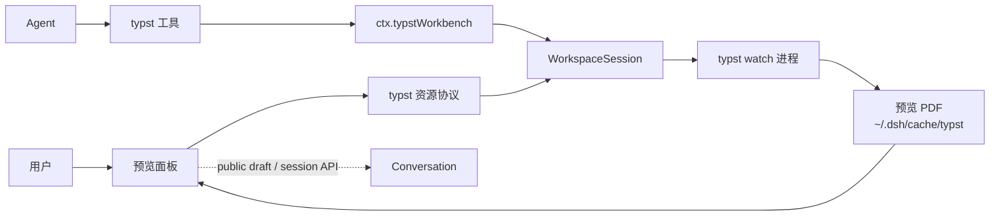

<a href="architecture.en.md"><b>English</b></a>

# 系统架构

dsh-typst 是一个请求驱动的插件：加载它不启动 typst，不触碰磁盘。第一个工具调用，或面板第一次订阅某个工作区，才为那个工作区建出会话。本文说明分层职责、数据流、服务表面与设计边界。

## 概述

host 半边由 `ctx.typstWorkbench`（`src/service.ts`）持有，它拥有按工作区根 realpath 键控的 `WorkspaceSession` 注册表、插件配置的生命周期、Typert manifest 与 scope 查找、7 个 Agent 工具，。浏览器半边由 `src/client/` 提供：一个右侧停靠栏 tab、`typst` 资源协议、`typst` wire 命名空间与工具卡片。

两半之间的契约是 `src/contract.ts` 里的视图类型与 `src/wire-schemas.ts` 里的严格 zod codec：host 端物化 host codec，客户端物化 client codec，两端共享同一份结构。

## 数据流

面板读状态走资源协议 `dsh-resource://typst/state/<sessionId>`：协议的首帧是当前状态，之后每帧对应一次相关变化。PDF 字节不在状态帧里，面板通过 `typst/readPreview` 按 generation/seq/sha256 精确拉取；快照含 main 与 compile run。候选 PDF 的首屏和文字层就绪后才替换可读预览。读取失败和旧快照明确显示；状态流失败通过新资源订阅重连。

## 核心分层

### 服务层 (`src/service.ts`)

`TypstWorkbenchService`（Cordis 键 `typstWorkbench`）是插件对外的稳定边界。它做四件事：按工作区根 realpath 键控地创建与复用 `WorkspaceSession`；注册 Typert manifest 与 `typstScope` 查找（把 wire 上的 SessionId 解析为工作区根，沿用 `workspaceFileScope` 的模式）；注册 7 个工具与 `typst` 技能；在 dispose 时关闭所有会话。

配置是 volatile 的：`loader/volatile-update` 触发时，所有活跃会话重新定位一次 typst 可执行文件，会话自行收敛而不重挂载。

### 会话层 (`src/workspace/session.ts`)

会话还区分**文档**与**片段**：片段是当前文档用 `#include`/`#import` 拉进去的 `.typ` 文件，由 typst 自己的依赖报告（`typst --deps`）点名。状态帧的 `fragments` 字段带着它，面板据此把两类文件分开列出。

typst 报告的是它解析过的路径，而解析过的路径是真实路径：macOS 的临时目录是 `/private/var` 的符号链接，所以报告与工作区根对同一个文件有两种写法。两边都解析后再比较，否则依赖报告会被静默丢弃——`sourceFiles()` 的选中定位曾因此找不到任何文件。

`WorkspaceSession` 是一个工作区的全部状态：工具链、主文件、watch 进程、快照、高亮、settle 语义与路径收敛。它对外暴露的是动作（`activate`、`setMain`、`settle`、`renderPages`、`exportPdf`、`highlight`、`locateSource`）与只读状态（`state()`），而不是进程细节。

路径安全在这一层落地：`insideWorkspace` 把每个路径解析为工作区内的绝对路径，越界的路径以 `TYPST_PATH_OUTSIDE_WORKSPACE` 拒绝。

### Typst 域 (`src/typst/`)

- **可执行文件定位**（`locate.ts`）：按设置 → PATH → 常见安装位置 → 登录 shell 的顺序查找，解析版本号并与 `MIN_TYPST`（0.12.0）比较。
- **watch 驱动**（`watcher.ts`）：唯一的进程生成点。自带进程组、pid 文件与树形清理；`reapOrphans` 回收上次异常退出的残留进程。
- **输出解析**（`diagnostics.ts`）：把 `typst watch` 的输出解析成 `WatchLog` 与诊断列表，含位置、源码行、`hint:` 与调用链。
- **主文件选择**（`mainfile.ts`）：扫描 `.typ` 候选并挑出主文件。
- **文本匹配**（`match.ts`、`text.ts`）：从渲染文本反查源码位置，产出引用、高亮矩形与摘录。
- **一次性编译**（`oneshot.ts`）：渲染页面与导出 PDF 走独立的编译，不经过 watch。
- **PDF 解析**（`pdf-extract.ts`）：用 pdf.js 读页数与页面文本。

### 工具层 (`src/tools/`)

`src/tools/registration.ts` 注册 7 个工具，每个工具一个 effect（注销即该 effect 的 teardown）。schema 用 dsh-tools 的值 schema DSL：`required` 是每属性的注解，嵌套 object 显式声明 `additionalProperties: false`。

canonical 输出是无损的 JSON（可选事实直接省略而非置 null），模型侧另有一份 `render` 文本。`typst_render_pages` 的 canonical 值带 base64 PNG，工具卡另行展示。

### Wire 层 (`src/typert.ts`、`src/contract.ts`、`src/wire-schemas.ts`、`src/status-codec.ts`)

wire 命名空间是 `typst`，服务键 `typstStatus`。manifest 是手写的：`ctx.typert.register()` 是官方为手写 wire schema 提供的路径，本仓库是独立 checkout，没有 Typert 生成器需要的 `tsconfig.host.json` 与 `packages/`。

`watch` 是流方法，manifest 的 signature 前缀 `@Remote({ mode: 'stream' })`，descriptor 上带 `mode: 'stream'`。`readPreview` 的字节过 wire 时走附件通道，`data` 字段是 `Uint8Array<ArrayBuffer>`。

插件自有域的错误在 wire 上只有一个码 `typst/domain`，稳定域码放在 `details.code`；消费方按 `details.code` 判别，而不是按 `instanceof`。

### 浏览器客户端 (`src/client/`)

- **预览面板**（`PreviewTab.tsx`）：右侧停靠栏 tab，kind `typst`，id `dsh-typst/preview`，作为 definition 与 keyed body 注册在同一 id 下。
- **资源协议**（`provider.ts`）：注册 `typst` 协议，地址 `dsh-resource://typst/state/<sessionId>`。
- **Remote 命名空间**（`remote.ts`）：挂载 `ctx.remote.typst`。`src/client/index.ts` 必须先 `await ctx.remote.$mount`，UI fiber 才能在 `remote.typst` 上注入。
- **PDF 渲染**（`pdf/`）：pdf.js Blob Worker，worker 源码经 esbuild `?raw` 内联。
- **大纲**（`pdf/outline.ts`）：typst 把标题层级写成 PDF 书签，pdf.js 的 `getOutline()` 读回来，`resolveOutline` 保留每个书签的完整目的地并解析页码。客户端完成，不需要 host 改动。
- **候选分组**（`candidates.ts`）：把 `.typ` 文件分成其他文件与已知依赖片段。
- **工具卡片**（`toolviews.tsx`）：注册进 `tool.call.toolview` keyed slot。

### 技能 (`src/skills/typst.ts`)

`typst` 技能通过 `ctx.skills.register` 注册，模型可调用也可由用户调用。它给出「定向 → 编辑循环 → 指向 → 面板输入 → 导出 → 引用 → 安装」的完整流程，是模型的默认行为路径。

反馈由浏览器公开的 `conversation.input.requestDraftInitialization`、`sessions.using`、`fileUpload.uploadImage` 和 `Session.prompt` 完成，不经过插件 host 的发送代理。`PreviewViewRegistry` 按会话与标签实例保留阅读位置、历史、大纲折叠和反馈；标签生命周期信号负责清理，隐藏和重挂载不会丢失草稿。

## 进程与生命周期

- 插件加载不生成进程；会话在首次使用时才建立。
- `typst watch` 只由 `src/typst/watcher.ts` 生成，独立进程组，pid 落盘，退出时树形清理。
- dispose 时所有会话被关闭（watch 随之退出）；进程退出钩子再兜底一次 `killNow`。
- 面板的流订阅在关闭时中止 host 侧的 watch 注册。

## 设计边界

- **不生成编译器**：插件不带 Typst，只调用用户已安装的那一个。
- **不改源文件**：Agent 用自己的文件工具编辑 `.typ`，插件只读。
- **不轮询**：面板的状态来自流，不来自定时器。
- **不联网**：插件自身零网络请求；Typst 下载 `@preview` 包与终端一致。
- **不并行编译**：同一工作区只有一个 watch 进程；渲染与导出走一次性编译，不占用 watch。
- **不跨工作区**：会话按工作区根隔离，两个工作区各自独立地预览。

## 导航与作用域

每个 wire 方法都带 `typstScope` 参数，服务端用 `typstScope` 查找把 wire 上的 SessionId 解析为工作区根后再执行方法体。因此同一宿主里的两个会话可以位于两个工作区，互不干扰。面板在客户端只传 sessionId，工作区根由 host 解析。
