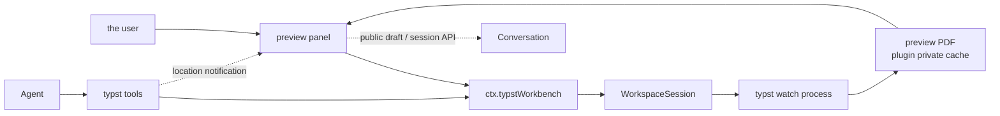

<a href="product-model.md"><b>中文</b></a>

# Product model

dsh-typst brings the ZCode typst-workbench panel into DeepSeek Harness's native front end. The Typst installed on your machine drives the right-sidebar preview, and the agent uses seven tools to work with the workbench.

## Vocabulary

| Term              | Meaning                                                                                                                                            |
| ----------------- | -------------------------------------------------------------------------------------------------------------------------------------------------- |
| Workbench         | The whole Typst state of one workspace: toolchain, main file, watch process, snapshots, highlights                                                 |
| Workspace session | The state machine in `src/workspace/session.ts`, keyed by the realpath of the workspace root, one per workspace                                    |
| Preview           | The PDF produced by `typst watch`, kept in the plugin's private cache and delivered to the panel as binary RPC through `typst/readPreview`         |
| Snapshot          | The bytes and metadata (generation/seq/run/pages/sha256) of one successful compile; the newest `LIMITS.snapshots` are kept                         |
| Highlight         | An annotation placed by `typst_show`: a quote plus PDF user-space rectangles, re-located by quote after a recompile, turning stale when it is gone |
| Main file         | The file handed to `typst compile`; chosen automatically, in the panel or with `typst_set_main`, remembered per workspace                          |
| Document          | The PDF compiled from the main file; other `.typ` files are not proven independently compilable                                                    |
| Fragment          | A `.typ` file the current document pulls in with `#include` or `#import`; compiling one on its own is rarely what the user means                   |
| Outline           | The document's heading hierarchy: the bookmarks typst writes into the PDF, whose complete destinations the panel preserves for precise navigation  |
| settle            | The waiting semantics of `typst_check`: it returns once every change already on disk has compiled; when the watch missed a change it is restarted  |

## Two entries

The system offers the model and the user separate entry points:

| Entry              | User         | Interaction                            | Responsibility                                                                                               |
| :----------------- | :----------- | :------------------------------------- | :----------------------------------------------------------------------------------------------------------- |
| **Agent tools**    | the AI model | model tool calls (function calling)    | orient to the workbench, read compile diagnostics, look at the layout, annotate the preview, export PDFs     |
| **User interface** | the user     | the browser panel in the right sidebar | read the live preview, read the problems list, select text and send it to the agent with its source location |

### Neither proxies for the other

The two paths keep their own jobs and never stand in for each other:

- **The interface never calls a tool**: Add to chat appends to the existing main composer draft. Questions, repairs and setup requests first enter an editable plugin draft; explicit submission uses public session and image APIs.
- **A tool call preserves reading**: location requests first produce a notification. The user clicks to navigate and can return to the previous reading position.

## One component

The plugin ships exactly one component:

| Component              | Role                                                                                                 | Default | Why it is not split                                                                                                                     |
| :--------------------- | :--------------------------------------------------------------------------------------------------- | :------ | :-------------------------------------------------------------------------------------------------------------------------------------- |
| **`dsh-typst` (core)** | locating the local typst, driving `typst watch`, 7 agent tools, the `typst` skill, the preview panel | enabled | the plugin's body; the preview and the process that feeds it live and die together, so there is no independently switchable sub-surface |

The core component holds both the host service (`ctx.typstWorkbench`) and the browser half. The panel reads and writes the same workbench state, so it starts and stops with the core component.

## Data flow

The panel never polls: state arrives on the host's `typst/watch` stream, and PDF bytes are pulled by exact generation/seq/sha256 identity. Expired reads fail explicitly.

## Four boundaries

1. **No source writes**: the plugin never edits a `.typ` file. `typst_export_pdf` writes inside the workspace, while preview artifacts go to the plugin's private cache directory (`~/.dsh/cache/typst`).
2. **No escape from the workspace**: every path is resolved and confined by `WorkspaceSession.insideWorkspace`; an escaping path is refused (`TYPST_PATH_OUTSIDE_WORKSPACE`).
3. **No network**: the plugin itself makes no network request. Typst downloads `@preview` packages on first use, as it does in a terminal.
4. **No takeover of `.pdf` opening**: a `.pdf` in the workspace is still opened by the host's built-in document preview; the plugin does not change that responsibility.

## Typical workflows

- **Typesetting and fixing in a conversation**: the agent calls `typst_status` to orient, calls `typst_check` right after editing a file to read the diagnostics, renders the affected pages with `typst_render_pages` when the layout is the problem, and points at the result with `typst_show`.
- **Checking in the panel**: the user reads the live preview in the right sidebar, opens the problems drawer for each error's file:line:column, source line, `hint:` lines and call trace, and sends a selected passage to the agent with the source location that matched it.
- **Delivering the artifact**: the agent writes the PDF into the workspace with `typst_export_pdf`, optionally with a PDF standard and a page selection; the preview's own PDF is not in the workspace.
