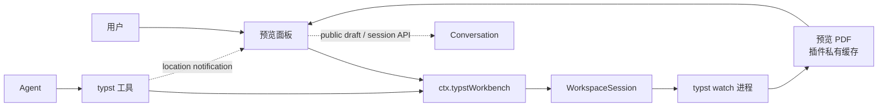

<a href="product-model.en.md"><b>English</b></a>

# 产品模型

dsh-typst 将 ZCode typst-workbench 的面板接入 DeepSeek Harness 的原生前端。插件用本机的 typst 驱动右侧栏预览，Agent 通过七个工具操作这个工作台。

## 词汇

| 词汇                         | 含义                                                                                              |
| ---------------------------- | ------------------------------------------------------------------------------------------------- |
| 工作台(Workbench)            | 一个工作区的 Typst 状态整体：工具链、主文件、watch 进程、快照、高亮                               |
| 工作区会话(WorkspaceSession) | `src/workspace/session.ts` 里的状态机，按工作区根 realpath 键控，一个工作区一个                   |
| 预览(Preview)                | `typst watch` 产出的 PDF，存于插件私有缓存，经 `typst/readPreview` 二进制 RPC 送达面板            |
| 快照(Snapshot)               | 一次成功编译的 PDF 字节 + 元数据(generation/seq/run/pages/sha256)；保留最近 `LIMITS.snapshots` 份 |
| 高亮(Highlight)              | `typst_show` 放置的标注：引文 + PDF 用户空间矩形，重编译后按引文重新定位，找不到转 stale          |
| 主文件(Main file)            | 传给 `typst compile` 的那个文件；自动选择、面板菜单或 `typst_set_main` 指定，按工作区记忆         |
| 文档(Document)               | 主文件编译出的 PDF；其他 `.typ` 文件是否能独立编译不能由索引判断                                  |
| 片段(Fragment)               | 被当前文档用 `#include`/`#import` 引用的 `.typ` 文件；单独编译它通常没有意义                      |
| 大纲(Outline)                | 文档的标题层级：typst 写进 PDF 的书签，面板保留书签完整目的地并精确导航                           |
| settle                       | `typst_check` 的等待语义：磁盘上已有的改动全部编译完成才返回；watch 漏改时重启它                  |

## 两个入口

系统为模型和用户提供独立的交互入口：

| 入口           | 使用者  | 交互方式                         | 职责                                                     |
| :------------- | :------ | :------------------------------- | :------------------------------------------------------- |
| **Agent 工具** | AI 模型 | 模型工具调用(Function Calling)   | 定向工作台、读取编译诊断、看排版、在预览中标注、导出 PDF |
| **用户界面**   | 用户    | 浏览器界面（右侧停靠栏预览面板） | 阅读预览、选择主文件、查看诊断、审阅文字或截图反馈       |

### 互不代理原则

两条路径各司其职，互不代理：

- **界面不直接调用工具**：「加入对话」追加主输入框草稿；「询问」、修复和安装请求先进入插件可编辑草稿，用户明确提交后通过公开会话接口发送。区域截图在插件草稿中审阅。
- **工具调用不干扰界面**：Agent 在后台调用工具编译、渲染或标注，先产生位置通知，用户点击才导航，支持返回原阅读位置。

## 一个组件

插件只有一个组件：

| 组件名称                | 角色                                                                         | 默认状态 | 拆分原因                                                           |
| :---------------------- | :--------------------------------------------------------------------------- | :------- | :----------------------------------------------------------------- |
| **`dsh-typst`（核心）** | 本机 typst 定位、`typst watch` 驱动、7 个 Agent 工具、`typst` 技能、预览面板 | 启用     | 插件主体；预览与其驱动的生命周期必须同生共死，没有可独立关闭的子面 |

核心组件同时包含 host 服务（`ctx.typstWorkbench`）和浏览器端。面板直接读写同一份工作台状态，因此与核心组件一起启停。

## 数据流

面板从不轮询：状态由 host 的 `typst/watch` 流推送，PDF 按 generation/seq/sha256 精确拉取；读取过期快照会明确失败，不能替换成最新字节。

## 四条边界

1. **不写源文件**：插件从不编辑 `.typ` 文件。写入发生在两处：`typst_export_pdf` 写入工作区，预览产物写入插件私有缓存目录（`~/.dsh/cache/typst`）。
2. **不越工作区**：每个路径都经 `WorkspaceSession.insideWorkspace` 解析并收敛，越界的路径被拒绝（`TYPST_PATH_OUTSIDE_WORKSPACE`）。
3. **不联网**：插件自身不发任何网络请求。Typst 首次使用 `@preview` 包时会自行下载，与终端一致。
4. **不接管 `.pdf` 打开**：工作区里的 `.pdf` 仍由宿主内置的文档预览打开，插件不改变这一职责。

## 典型工作流

- **在对话中排版与修复**：Agent 先 `typst_status` 定向，改完文件立即 `typst_check` 读诊断，布局问题用 `typst_render_pages` 看图，需要指给用户看时用 `typst_show`。
- **在面板中核对**：用户在右侧栏看实时预览，展开底部问题辅助区读每条错误的文件:行:列、源码行、`hint:` 与调用链，选中文字或框选区域，审阅问题与源码候选后提交。
- **交付成品**：Agent 用 `typst_export_pdf` 把 PDF 写进工作区，可选 PDF 标准与页选择；预览自己的 PDF 不在工作区里。
